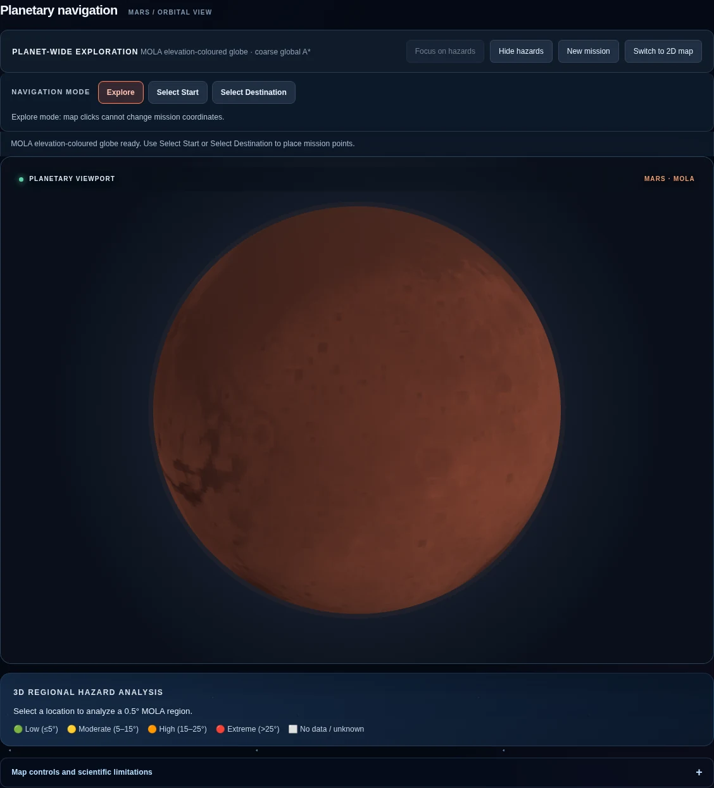
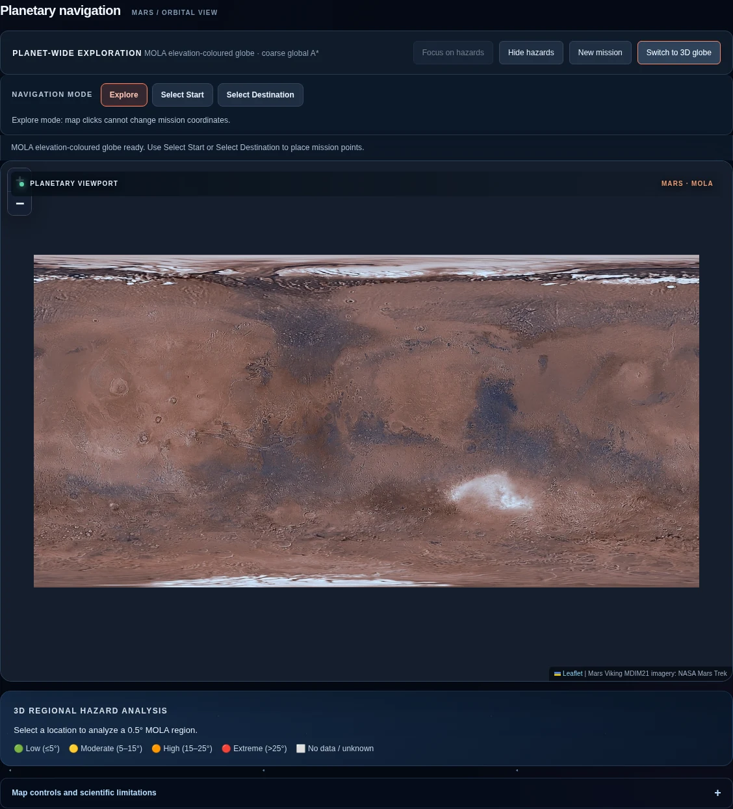
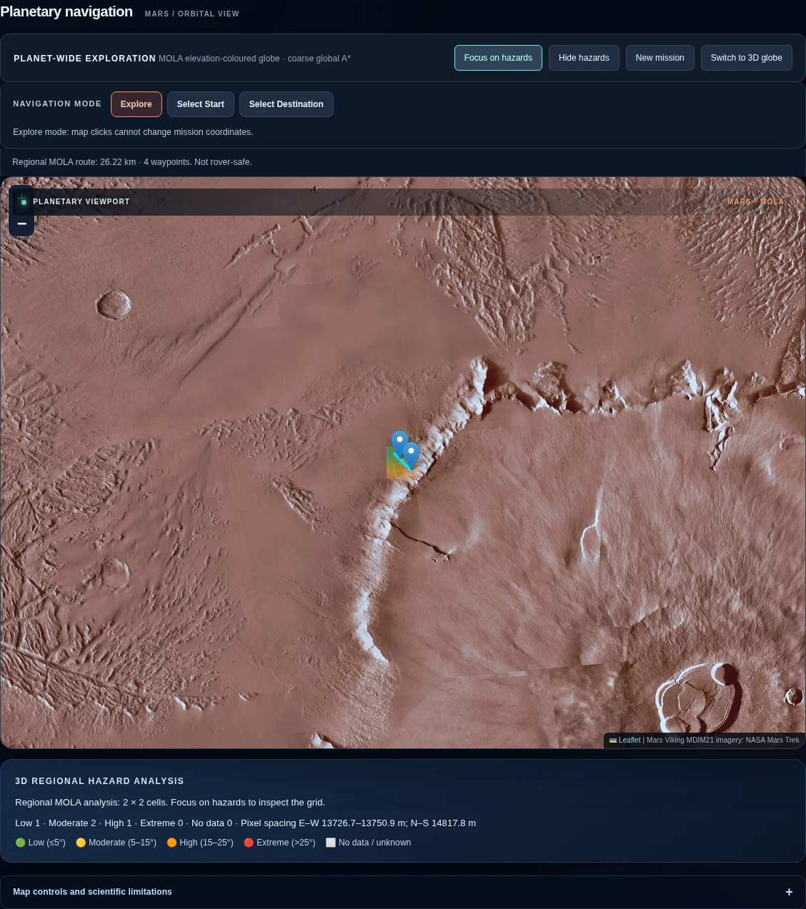
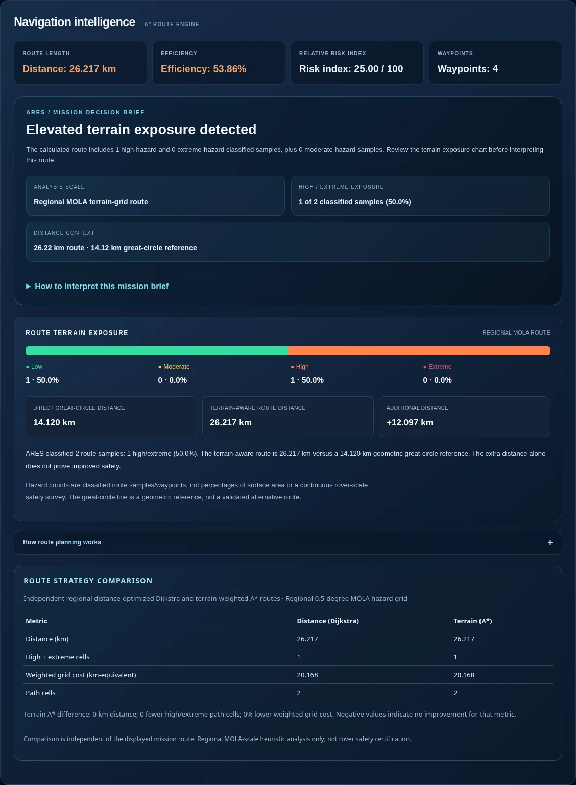
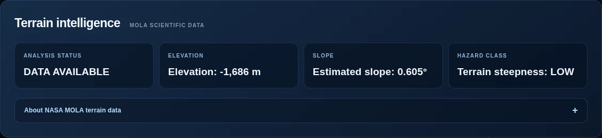
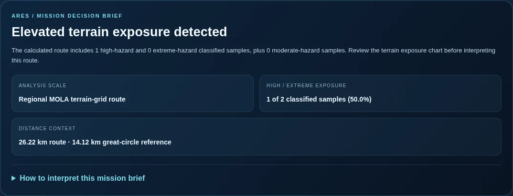
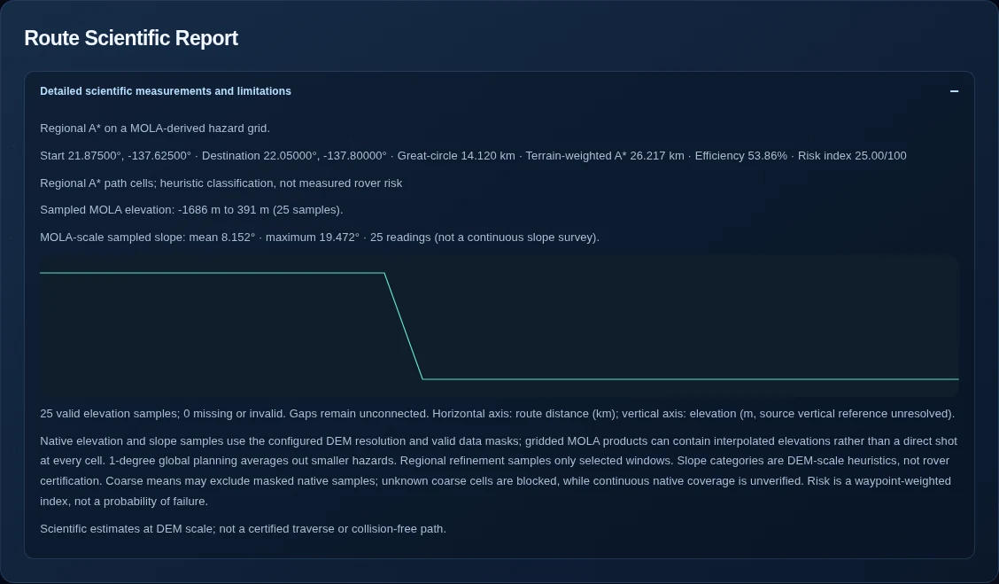
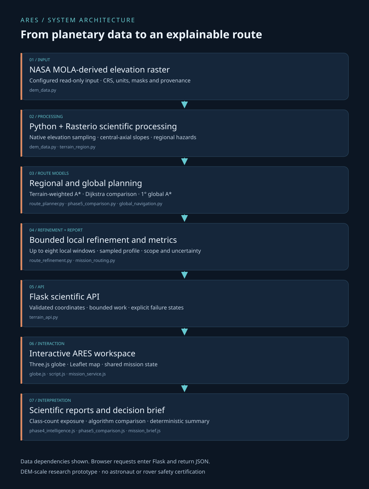

# ARES

### Read the terrain. Compare the route. Explain the limits.

**Autonomous Reconnaissance and Exploration System** is a Mars terrain-intelligence and modeled route-planning application. Explore a planetary globe, sample NASA-derived elevation data, inspect DEM-scale slope categories, and compare the consequences of different route objectives in one workspace.

**Creator and Project Lead:** Nivaan Raina · Independently directed solo project

**Selected NASA Space Apps challenge:** [Interplanetary Survival Guide: Martian Map](https://www.spaceappschallenge.org/2026/challenges/interplanetary-survival-guide-martian-map/)

**Status:** Research and educational prototype. Terrain intelligence is demonstrated; a complete astronaut survival-planning system is not implemented.

[Explore the interface](#inside-the-workspace) · [Scientific methods](docs/METHODOLOGY.md) · [Route models](docs/ROUTING_ALGORITHMS.md) · [Evidence](#validation-with-evidence-boundaries) · [Run ARES](#install-and-run) · [Challenge alignment](docs/CHALLENGE_ALIGNMENT.md)



*Actual ARES browser capture. This gallery uses a separate, hash-verified native MOLA PDS reference at 4 samples/degree, not the owner's full-resolution derivative. It demonstrates the interface and coarse-scale calculations. [Capture inputs, network conditions and all seven views](docs/SCREENSHOT_GALLERY.md).*

## The problem

A line between two Martian coordinates says little about the terrain beneath it. A planner needs to see elevation, understand the scale of a slope estimate, compare route objectives, and recognize where available data cannot answer a safety question.

ARES brings those steps together. Its contribution is the integration of planetary visualization, raster analysis, computational routing, comparison and explainable reporting. NASA created the underlying scientific products; A* and Dijkstra are established algorithms. ARES does not claim to have invented them.

## From exploration to a decision brief

| Capability | What the application actually does |
| --- | --- |
| Planetary exploration | Linked Three.js globe and Leaflet map with shared start/destination state and exact coordinate entry |
| Native terrain sampling | Reads the configured raster's elevation and estimates slope using native axial neighbors |
| Regional hazard screening | Displays LOW, MODERATE, HIGH and EXTREME slope categories; unknown support remains unavailable |
| Regional planning | Calculates terrain-weighted A* paths on the analyzed grid |
| Algorithm comparison | Independently compares distance-only Dijkstra and terrain-weighted A* on the same regional grid |
| Global planning | Uses a 360 × 180, 1° averaged model with bounded local refinement; discloses the coarser scope |
| Route Intelligence | Shows route length, geometric efficiency and class-count terrain exposure |
| Scientific reporting | Reports estimated elevation/slope metrics, a sampled elevation profile and model limitations |
| Mission Decision Brief | Converts existing results into deterministic explanatory text; adds no new observations |

## Inside the workspace

All images below are genuine application states using the separate **4 ppd native PDS reference**. Near the equator, its 0.25° native pixels span roughly 14.8 km. These coarse pixels cannot show rover-scale obstacles. Captions and the capture manifest identify the exact coordinates, source hash and basemap conditions.

| Planetary map | Regional slope-category overlay |
| --- | --- |
|  |  |

| Route Intelligence | Science Lab |
| --- | --- |
|  |  |

| Mission Decision Brief | Route Scientific Report and elevation profile |
| --- | --- |
|  |  |

[Open the full gallery and reproduction instructions →](docs/SCREENSHOT_GALLERY.md)

## NASA data and scientific foundation

The analytical input is a configured **MOLA-derived digital elevation model**. MOLA, the Mars Orbiter Laser Altimeter aboard Mars Global Surveyor, provides planetary topography products. A gridded elevation pixel may incorporate interpolation; it is not necessarily an independent laser observation at that location.

The owner's derivative and the public native PDS reference are different inputs. The original derivative is kept outside this repository. [Scientific inputs](docs/SCIENTIFIC_INPUTS.md) and [dataset provenance](docs/DATASET_PROVENANCE.md) record metadata, checksums, comparisons and unresolved processing/vertical-reference questions. A later owner-side full-file checksum and two regional integration passes are recorded separately from the earlier sample tests.

NASA Mars Trek Viking MDIM21 **basemap imagery** and the NASA/JPL-Caltech Viking Orbiter **hero image** are separate from analytical elevation data. Neither supplies route measurements. ARES does not claim NASA endorsement.

### Method in brief

1. Validate supported raster geometry, masks, scale/offset and elevation units. Missing unit metadata is disclosed; known incompatible inputs are rejected.
2. Sample elevation at the native cell containing the requested coordinate. Estimate slope from the centre and four axial neighbors, with latitude-dependent physical spacing and a documented spherical/mean-radius approximation.
3. Classify valid slopes using the existing screening categories below. Missing centre/support data stays unknown.
4. Plan on the regional grid or the coarse global model, retaining explicit scope and unavailable-data states.
5. Return geometric route metrics, sampled reports and limitations to the shared browser workspace.

| Category | Estimated DEM-scale slope | Regional routing penalty |
| --- | --- | --- |
| LOW | ≤5° | 1 |
| MODERATE | >5° to 15° | 3 |
| HIGH | >15° to 25° | 8 |
| EXTREME | >25° | 20 |

These are illustrative categories, not astronaut or rover safety thresholds. EXTREME has a finite penalty; unknown cells and blocked diagonal corners cannot be traversed. [Full methodology →](docs/METHODOLOGY.md)

## Architecture



[Module responsibilities and request/response diagram →](docs/ARCHITECTURE.md)

## Route-planning models

| Model | Objective and scope | How to interpret it |
| --- | --- | --- |
| Terrain-weighted A* | Accumulated distance × destination-cell terrain penalty, plus a distance heuristic; regional grid | Lower modeled grid cost can favor a longer path. Cost is not energy, travel time or physical mission risk. |
| Distance-only Dijkstra | Lowest summed inter-cell distance on the same available regional grid | A controlled regional comparison, not proof of a safe shortest traverse. |
| Coarse global A* | Coordinate-aligned 1° means, global geometry and sampled local refinement | Broad planetary route exploration; at most eight local windows are inspected. Small hazards and continuous native coverage remain unresolved. |

Displayed route distance includes requested endpoint connectors; the regional comparison's weighted grid cost excludes those connectors. The great-circle reference is a geometric lower-distance context, not a validated traversable alternative. The separate terrain risk index counts class exposure; it is not a failure probability. [Algorithm details and diagrams →](docs/ROUTING_ALGORITHMS.md)

## Validation with evidence boundaries

| Evidence | Supported result | What it does not establish |
| --- | --- | --- |
| Historical real 256 × 256 derivative sample | All 65,536 pixel-centre lookups matched; a virtually warped USGS source window reproduced all sample values | Identity of the entire parent file or independent observational accuracy |
| Native PDS product comparison | 10,113 of 65,536 values matched exactly; MAE 3.303 m, RMSE 5.167 m, maximum difference 84 m | That native PDS and a regridded derivative are interchangeable |
| Historical software/browser run | 70 named Python passes and two full-original-DEM skips; eight Node regressions; two synthetic and two real-backend browser scenarios | Testing of the skipped input or operational safety |
| Later owner full-DEM verification | Read-only checksum and two regional integration smoke passes recorded in the scientific addendum | New execution here, independent ground truth, or continuous global corridor validation |
| Public 4 ppd reference | Separate real-data global/dateline/polar checks; actual-backend gallery | The owner's full-resolution dataset or rover-scale terrain detail |

Fresh checks for this submission-readiness branch are recorded in [submission readiness](docs/SUBMISSION_READINESS.md) and separate evidence files; they do not overwrite historical outcomes. [Reproduce the tests →](docs/VALIDATION.md) · [Detailed scientific validation →](docs/SCIENTIFIC_VALIDATION.md)

## Challenge alignment

ARES addresses the **terrain-mapping and modeled route-exploration** portion of *Interplanetary Survival Guide: Martian Map*. It lets a user connect locations to terrain evidence and inspect the consequences of route objectives.

The owner selected the challenge. Its official title/URL is indexed, while the full live statement could not be retrieved in this review. An institutional event page reproduces a layered, multi-mission Marswalk overview; detailed official requirements remain unverified. The [alignment matrix](docs/CHALLENGE_ALIGNMENT.md) separates demonstrated features, partial coverage, missing capabilities and source uncertainty.

ARES currently analyzes one elevation-input family, not a complete multi-mission survival atlas. It has no environmental forecast, radiation model, life-support budget, EVA timing model or astronaut-specific safety certification.

## Limits that matter

- DEM resolution and interpolation conceal small rocks, narrow gaps and wheel/foot-scale obstacles.
- Slopes, penalties and class-count exposure are models, not calibrated mobility or accident probabilities.
- Global averaging and sparse refinement do not validate an entire traverse at native resolution.
- Derivative processing history and vertical-reference inheritance need stronger source documentation.
- Vehicle geometry, soil strength, slippage, illumination, thermal conditions, dust, communications and human/EVA constraints are not modeled.

These boundaries define a useful research and educational terrain-planning aid. They also define what needs evidence before stronger claims can be made. [Complete limitations →](docs/LIMITATIONS.md)

## Install and run

Python **3.12** is the tested target. From a checkout of this repository:

```bash
python3.12 -m venv .venv
. .venv/bin/activate
python -m pip install -r requirements-tested.txt
export ARES_DEM_PATH='/absolute/path/to/your/authorized/mola-dem.tif'
python terrain_api.py
```

Open **http://127.0.0.1:5001**. Keep the original raster unchanged and outside publicly served assets. Without `ARES_DEM_PATH`, the application checks `data/mola128_mola64_merge_90Nto90S_SimpleC_clon0.tif` relative to the source directory. The original DEM and historical sample are not bundled.

For a separately identified coarse public reference demo, instead of the original derivative:

```bash
python scripts/prepare_global_reference.py --output /tmp/ares-reference-new
export ARES_DEM_PATH='/tmp/ares-reference-new/pds_megdr_4ppd_reference.tif'
python terrain_api.py
```

Use a fresh output directory; the preparation script verifies the source hash and refuses existing files. This is a native **4 ppd** product, not the original high-resolution derivative.

The interface loads without a DEM and exposes dataset errors explicitly. `/healthz` checks liveness. `/readyz` checks raster compatibility and full-planet coverage; a valid regional sample intentionally returns 503 with regional capability available and global capability unavailable.

`requirements.txt` specifies compatibility ranges; `requirements-tested.txt` preserves the historically tested exact environment. Optional browser and production manifests are separate. See [dependencies](docs/DEPENDENCIES.md), [test instructions](docs/VALIDATION.md) and [deployment](DEPLOYMENT.md). No public deployment or submission is implied.

## Project map

| Location | Purpose |
| --- | --- |
| `terrain_api.py`, `dem_data.py`, `terrain_region.py` | API, raster validation/sampling and regional analysis |
| `route_planner.py`, `global_navigation.py`, `route_refinement.py` | Regional/global models and bounded refinement |
| `mission_routing.py`, `phase5_comparison.py` | Mission report and independent algorithm comparison |
| `index.html`, `*.js`, `*.css` | Interactive globe/map, dashboards and deterministic brief |
| `test_*.py`, `tests/` | Numerical, contract, browser and frontend regressions |
| `docs/` | Methods, challenge alignment, gallery, evidence and historical reports |
| `vendor/` | Pinned frontend libraries, upstream licenses and checksums |

## Future development

Priorities are to verify the complete official challenge brief, document derivative acquisition/processing, validate additional real traverses, evaluate threshold sensitivity and measure utility with actual users. A future layered atlas could add cited scientific points of interest and independently validated environmental datasets. Any human/EVA or vehicle model would require its own assumptions, calibration and tests; these are plans, not existing features.

## References and credits

- Smith, D. E., Zuber, M. T., Neumann, G. A., Guinness, E. A., and Slavney, S. **(2003)**. *Mars Global Surveyor Laser Altimeter Mission Experiment Gridded Data Record*, **MGS-M-MOLA-5-MEGDR-L3-V1.0**. NASA Planetary Data System. [Dataset record](https://pds.nasa.gov/ds-view/pds/viewProfile.jsp?dsid=MGS-M-MOLA-5-MEGDR-L3-V1.0). Product-specific labels and comparison methods are linked in [dataset provenance](docs/DATASET_PROVENANCE.md).
- NASA/JPL-Caltech, Viking Orbiter mosaic. [Mars Planet Globe](https://science.nasa.gov/resource/mars-planet-globe/). Hero image resized to 600 × 600 and converted from JPEG to PNG; NASA endorsement is neither claimed nor implied.
- Leaflet 1.9.4; Three.js 0.160.1 and OrbitControls. Original upstream notices and licenses are retained in [third-party notices](THIRD_PARTY_NOTICES.md) and `vendor/`.

**Nivaan Raina** is the creator and project lead. ChatGPT assisted with implementation, debugging, technical audit, numerical analysis, testing, documentation and interface work. Runtime routes use explicit terrain algorithms; the mission brief interprets calculated outputs with deterministic rules.

Original ARES software and documentation: **MIT License**, Copyright © **2026 Nivaan Raina**. See [LICENSE](LICENSE), [AUTHORS.md](AUTHORS.md) and [COPYRIGHT](COPYRIGHT). NASA datasets, imagery and vendored libraries retain their separate applicable rights; see [asset provenance](ASSET_PROVENANCE.md).

[Development history](DEVELOPMENT_HISTORY.md), dated scientific evidence and [the date-reference audit](docs/DATE_REFERENCE_REVIEW.md) remain preserved. [Initial audit](docs/INITIAL_AUDIT.md) and [completion report](docs/SUBMISSION_READINESS.md) distinguish the current changes from earlier work.
