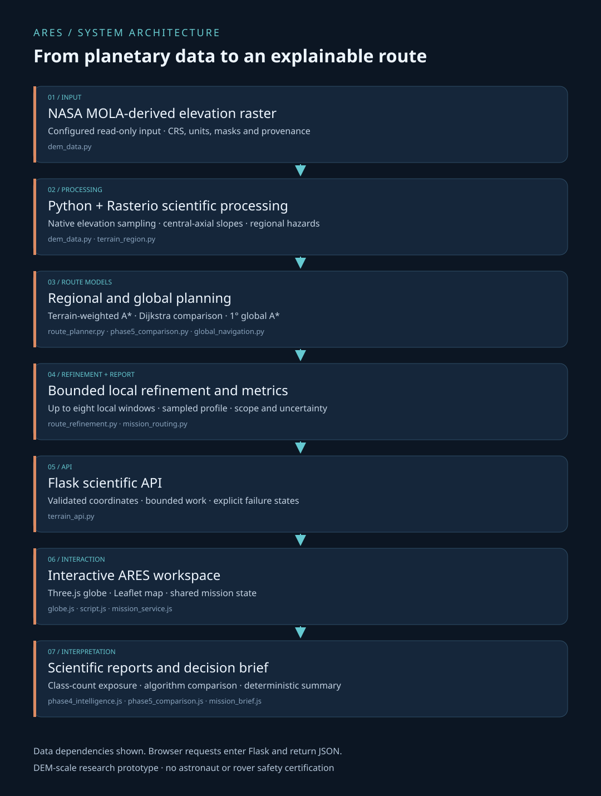

# Architecture: from topography to an explainable route



The diagram follows the scientific data dependency. HTTP requests start in the frontend, enter Flask, call the relevant processing/routing modules and return JSON. An analysis does not run the entire pipeline for every request.

| Layer | Responsibility | Implementation |
| --- | --- | --- |
| External input | Read-only configured MOLA-derived raster; masks, CRS, resolution, scale/offset and units | `ARES_DEM_PATH`; [dem_data.py](../dem_data.py) |
| Scientific processing | Validate geometry; sample elevation; estimate central-axial slopes; analyze a regional grid | [dem_data.py](../dem_data.py), [terrain_region.py](../terrain_region.py) |
| Route models | Regional terrain-weighted A*, distance-only regional Dijkstra; coarse global A* and bounded local refinement | [route_planner.py](../route_planner.py), [phase5_comparison.py](../phase5_comparison.py), [global_navigation.py](../global_navigation.py), [route_refinement.py](../route_refinement.py) |
| Orchestration and report | Select regional/global scope; calculate geometric metrics; sample elevation profile and disclose limits | [mission_routing.py](../mission_routing.py) |
| HTTP service | Coordinate validation, bounded expensive work, JSON contracts, health/readiness; allowlisted frontend serving | [terrain_api.py](../terrain_api.py) |
| Browser workspace | Three.js globe, Leaflet map, shared endpoints, request cancellation and error states | [globe.js](../globe.js), [script.js](../script.js), [mission_state.js](../mission_state.js), [mission_service.js](../mission_service.js) |
| Interpretation | Route exposure dashboard, independent algorithm comparison, scientific report, deterministic decision brief | [phase4_intelligence.js](../phase4_intelligence.js), [phase5_comparison.js](../phase5_comparison.js), [mission_brief.js](../mission_brief.js) |

## Request and response flow

```mermaid
sequenceDiagram
    participant U as Explorer
    participant B as Browser / shared mission state
    participant F as Flask API
    participant S as Rasterio / route modules
    U->>B: Select coordinates and calculate
    B->>F: GET /api/mission-route + endpoints
    F->>F: Validate coordinates and analysis capacity
    F->>S: Analyze region; choose regional or global route
    S-->>F: Model outputs, profile and limitations
    F-->>B: JSON response or explicit unavailable/error state
    B-->>U: Map/globe, exposure, report and brief
    B->>F: GET /api/route-comparison (independent)
    F->>S: Same-grid Dijkstra versus terrain-weighted A*
    S-->>F: Comparison, or not_comparable
    F-->>B: Independent comparison response
```

## Data boundaries

NASA Mars Trek Viking MDIM21 **imagery** is an external map layer, separate from the configured MOLA **elevation** raster. The globe uses a DEM-derived elevation-coloured canvas when available and a disclosed fallback otherwise. The NASA/JPL-Caltech hero image is an illustration, not an analytical input. Browser test fixtures are isolated test responses; production does not substitute synthetic terrain when a dataset fails.

The original DEM remains outside source control and outside publicly served assets. Flask serves only reviewed frontend files plus vendored libraries. `/healthz` tests process liveness; `/readyz` tests configured raster compatibility/coverage. Neither proves physical scientific accuracy. See [deployment](../DEPLOYMENT.md) for service configuration and [limitations](LIMITATIONS.md) for model boundaries.
