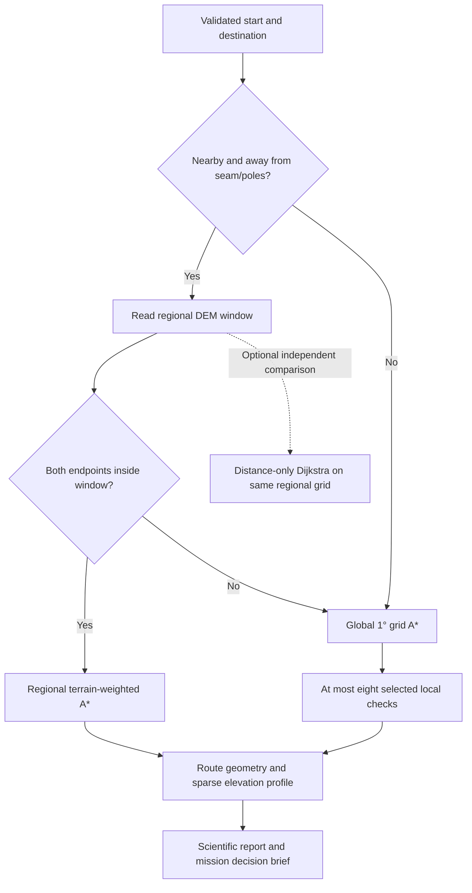

# Route-planning algorithms

ARES combines established graph-search algorithms with its terrain visualization and reporting workflow. Its contribution is the integration of NASA-derived elevation, explicit slope-screening assumptions, shared mission state and interpretable comparisons. A* and Dijkstra's algorithm are established methods; ARES does not claim to have invented them.

## Selecting the planning scale



[mission_routing.py](../mission_routing.py) tries regional analysis when both coordinate differences are at most 0.24°, accounting for wrapped longitude, and the start is away from polar/seam boundaries. Both endpoints must actually fit the returned window. If a regional result cannot be formed, the workflow can use global planning, which requires suitable full-planet input. A regional `no_route` result remains a failure rather than a fabricated alternative.

## Terrain-weighted A*

[route_planner.py](../route_planner.py) represents available regional cells as a graph with eight movement directions. Unknown cells and unknown side cells at a diagonal corner cannot be crossed. EXTREME is a high finite cost, not a hard obstacle.

For a move from cell `u` to `v`:

```text
step_cost(u, v) = distance(u, v) × terrain_multiplier(class(v))
g(v) = best accumulated modeled cost from start to v
f(v) = g(v) + h(v)
terrain_multiplier = [1, 3, 8, 20] for [LOW, MODERATE, HIGH, EXTREME]
```

A priority queue expands the smallest available `f`; improved costs update the parent chain. With geographic bounds, each edge and heuristic use spherical great-circle distances between cell centres. Because the smallest multiplier is 1, direct great-circle distance is a lower bound on remaining modeled cost. Without bounds, the synthetic-grid mode uses unit/diagonal distances and an octile-distance heuristic.

The multiplier belongs to the destination cell, so the modeled cost can differ when a path is reversed. It has distance units multiplied by an illustrative penalty. It is not measured energy, travel time, astronaut effort or failure probability.

A* minimizes this grid objective. It need not return the shortest geographic route, or fewer non-LOW cells: length, severity and destination-cell penalties jointly influence the result. Report a benefit only when the actual comparison supports it.

## Distance-oriented Dijkstra comparison

[phase5_comparison.py](../phase5_comparison.py) runs Dijkstra using a priority queue keyed only by accumulated physical grid-edge distance, equivalent to a zero heuristic and no slope multipliers. It uses the same regional grid, endpoints, available cells, eight directions and blocked-corner policy as terrain-weighted A*.

| Question | Distance-only Dijkstra | Terrain-weighted A* |
| --- | --- | --- |
| Optimized quantity | Sum of spherical cell-centre edge lengths | Sum of edge length × destination-cell terrain penalty |
| Remaining-cost estimate | None | Direct great-circle lower bound |
| Effect of high slope | Traversable if classified | Traversable with higher cost |
| Unknown cells | Blocked | Blocked |
| Meaning of result | Distance-oriented route on this graph | Lowest modeled terrain cost on this graph |

The comparison is limited to a common regional window. It cannot fairly compare the same-grid objective to a global route with different resolution. Results include route length, class counts, high/extreme cells and weighted grid cost. Weighted-cost improvement is relative to the Dijkstra route evaluated under the same terrain-cost function, not an improvement in measured mission safety.

Multi-cell displayed paths retain exact requested endpoints and cell-centre geometry. Their total length includes endpoint connectors; the weighted grid cost excludes these connectors. Same-cell paths connect endpoints directly after verifying that the cell is available. Therefore the grid-optimal distance route is not a claim of a globally shortest continuous path through real terrain.

## Coarse global A*

[global_navigation.py](../global_navigation.py) builds a longitude-wrapped 360 × 180 graph from 1° average elevations. It calculates coarse slope classes and applies the same 1/3/8/20 penalties to spherical edge lengths. Unknown cells block routing and diagonal corner cutting. Dateline wrapping is explicit; the poles use adjoining latitude bands as a spherical convention.

The algorithm uses exact start/destination coordinates for endpoint edges and coarse centres for interior geometry. For routes shorter than 300 km, a direct geodesic may replace the cell-centre geometry if sampled coarse cells and a conservative intervening-cell cover are all LOW. This is a coarse screening shortcut, not proof that every native pixel along that arc is safe.

One degree is roughly 59 km north–south on this distance model. Averaging before slope estimation removes narrow hazards. Global output is an illustrative corridor whose resolution must remain visible in a demonstration.

## Bounded local refinement

[route_refinement.py](../route_refinement.py) selects at most eight coarse segments and reads a nominal 0.5° native window near each selected midpoint. It attempts a local terrain-weighted A* detour over a bounded central part of that segment. Tiny segments, boundary/polar windows, insufficient bounds and unavailable inputs are reported separately.

A candidate is accepted only if the implementation's class-count penalty improves, its length is at most 1.5 times the local direct reference (with a 0.1 km floor), and either its highest class decreases or its penalty is at most 75% of the prior sampled line's penalty. This acceptance score uses class weights 0/1/3/6, distinct from A*'s distance-weighted 1/3/8/20 objective.

Reports separate attempted, sampled, skipped, unavailable and modified windows. Their segment fraction counts selected segments with a sampled window; it is not a fraction of route length continuously verified. The global class counts and risk index remain coarse; refinement does not rescore full-route exposure at native resolution.

## Route metrics and reporting

| Metric | Actual meaning |
| --- | --- |
| Route distance | Sum of shortest spherical arcs joining returned route coordinates, using a 3,389.5 km radius |
| Direct distance | Great-circle distance between requested endpoints on the same sphere |
| Efficiency | Direct distance divided by route distance, expressed as a percentage |
| Hazard breakdown | Counts of classified regional path cells, or coarse global path cells |
| Risk index | `100 × (MODERATE + 3 × HIGH + 6 × EXTREME) / (6 × path_cells)` |
| Elevation profile | Native DEM lookups at sparse positions along the returned spherical route geometry |

The unified mission report requests 25 profile samples. Missing elevations/slopes remain unavailable and profiles retain gaps. Risk and class counts are not percentages of surface area, probability of failure or continuous traversability. The deterministic [mission brief](../mission_brief.js) explains these calculated results; it is not conversational AI route generation or autonomous spacecraft control.

## Evidence and reproduction

- [Regional routing invariants](../tests/test_cross_module_regressions.py) compare production A* cost with a reference Dijkstra search and test corner blocking and geometry.
- [Mission tests](../test_mission_routing.py) exercise endpoint preservation, same-cell routes, precision and report behavior.
- [Global tests](../test_global_navigation.py) cover wrapped geometry and unavailable endpoints using controlled grids.
- [Refinement tests](../test_route_refinement.py) distinguish geodesic interpolation, sampled-window accounting and synthetic local detours.
- [Real sample/reference tests](../tests/test_sprint_validation.py) require the specifically identified external inputs and skip explicitly when absent.

See [validation commands](VALIDATION.md), [recorded results](SCIENTIFIC_VALIDATION.md) and [limitations](LIMITATIONS.md) before interpreting a demonstration.
