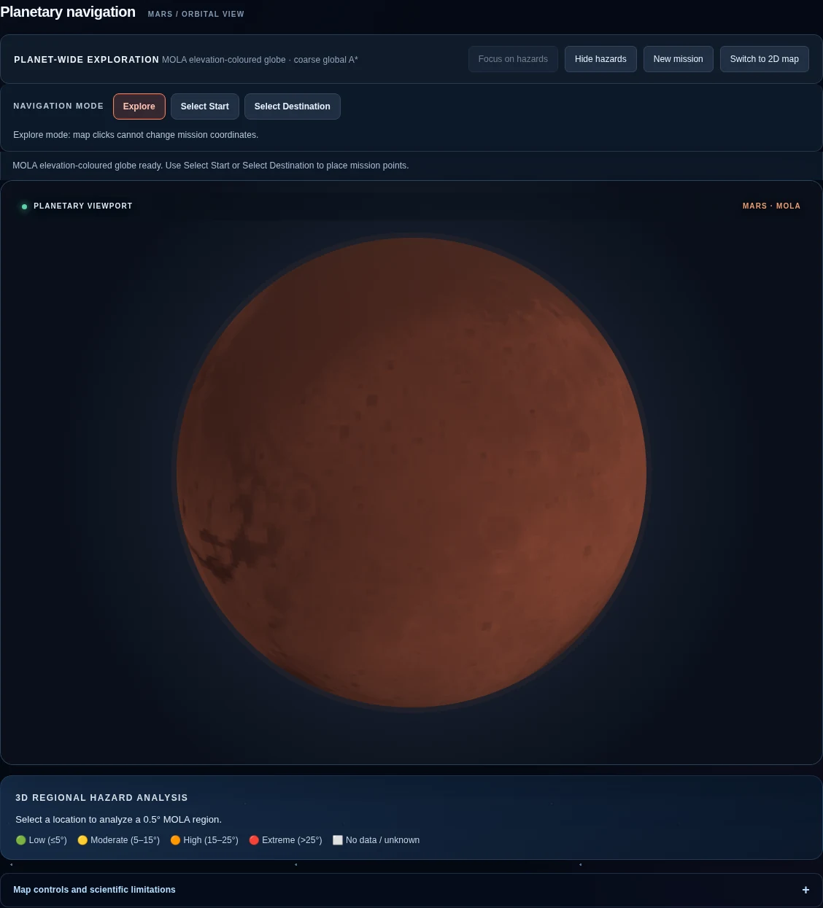
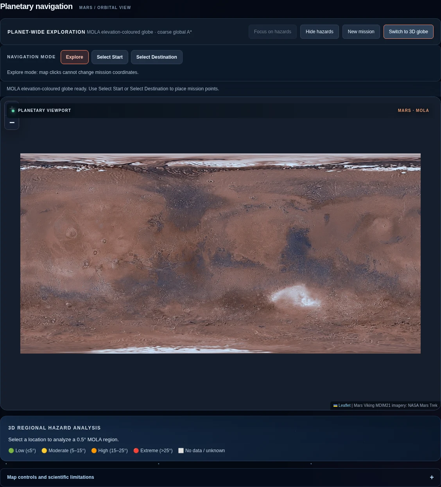
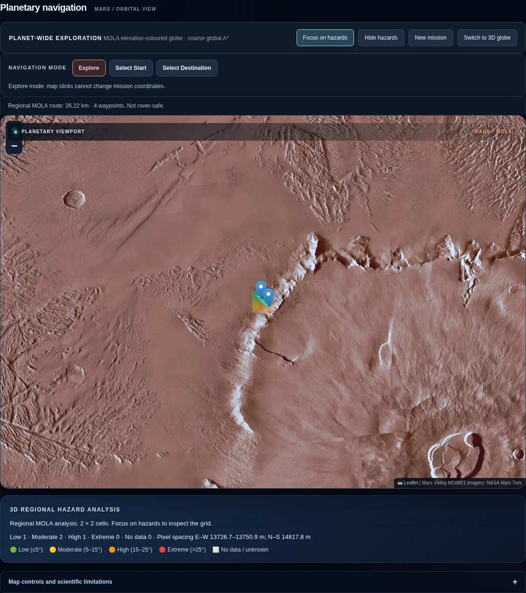
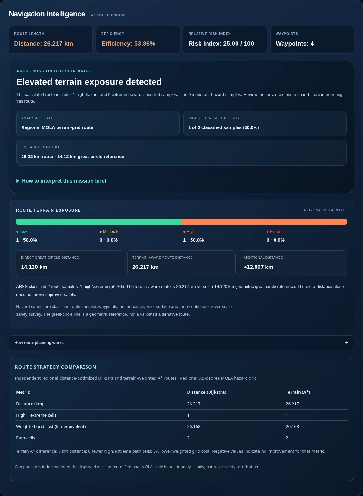
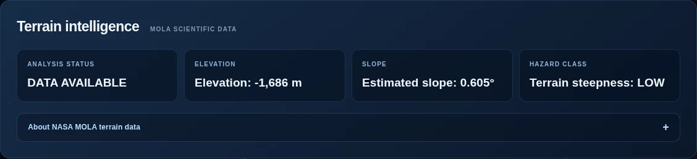
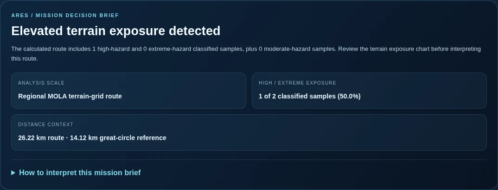
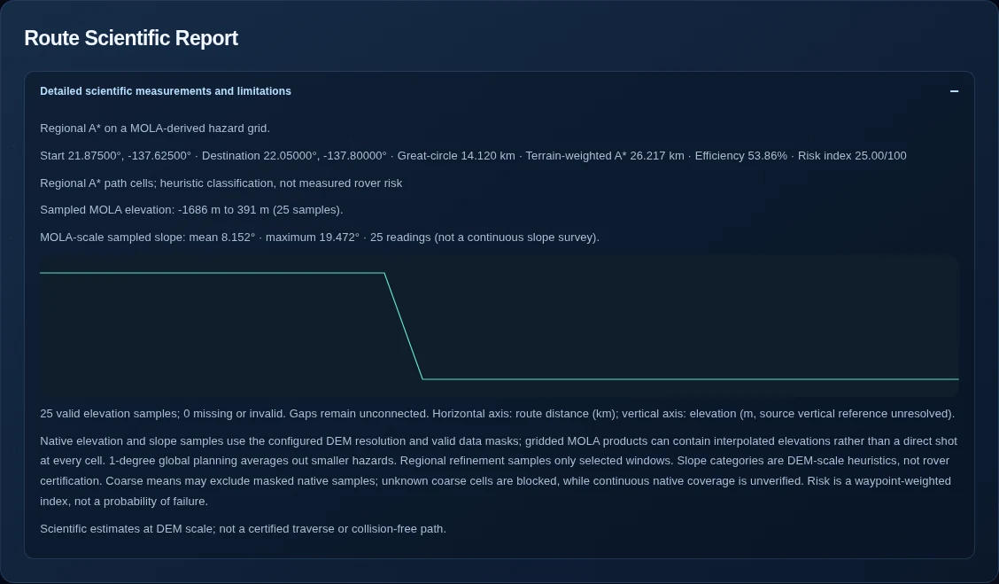

# ARES — working application gallery

These are direct browser captures of the running ARES interface. Flask, Rasterio, Leaflet and Three.js produced the displayed state; no scientific API response or displayed value was mocked, and no image is a design mockup or composite. Images are panel crops encoded as WebP for GitHub. [Capture evidence](evidence/gallery_capture.json) records inputs, runtime versions, reference checks, real API responses, tile sources and image hashes.

## What data is shown

**Every screenshot uses the separate native NASA PDS MOLA MEGDR 4-samples-per-degree reference**, `MEGT90N000CB.IMG`. It is a public real-data reference, not the owner's full-resolution local DEM and not a synthetic fixture. The [preparation script](../scripts/prepare_global_reference.py) verifies the original product's SHA-256 and converts signed big-endian values to GeoTIFF without resampling. The original DEM is neither bundled nor changed.

The reference's native north–south pixel spacing is approximately **14.8 km**. The globe's relief is derived from the application's coarser global model. The regional example uses a real **2 × 2 native-pixel grid** around `(21.875°, −137.625°)` near Olympus Mons, with destination `(22.05°, −137.8°)`. Its grid has one LOW, two MODERATE and one HIGH cell. The hazard patch appears small because the normal “Focus on hazards” control sets the application's maximum map zoom of 6; the capture preserves that actual scale.

NASA Mars Trek Viking MDIM21 imagery supplies visual context in the 2D map; it is separate from the MOLA terrain calculations. Chromium did not trust this environment's CA for direct Trek requests. The capture tool retrieved the **same actual NASA tile URLs over verified Python HTTPS** and delivered their original bytes to the browser. No TLS verification was disabled and no replacement tiles were invented. All 32 fetched tile URLs, successful responses and hashes are in the manifest. The gallery demonstrates that recorded capture, not universal browser or tile-service availability.

## 1. Interactive 3D Mars globe



The live Three.js globe rendered the backend's MOLA-derived global relief. This overview has no mission selected. The relief colours communicate elevation context; they are not a photorealistic image or a continuous local hazard survey.

## 2. Two-dimensional planetary map



The actual Leaflet view uses the same mission state as the globe. The external imagery is credited to NASA Mars Trek; elevation and hazard calculations use the configured MOLA reference.

## 3. Regional hazard visualization



The plotted patch contains native LOW/MODERATE/HIGH screening classes. The readout reports 13,726.7–13,750.9 m east–west and 14,817.8 m north–south spacing. A two-cell path through this coarse grid does not imply astronaut or rover traversability.

## 4. Route Intelligence



The recorded route is **26.217 km**, versus a **14.120 km** great-circle reference, with four returned waypoints and two classified grid cells (one LOW, one HIGH). Endpoint-to-cell-centre connectors contribute to displayed distance. Dijkstra and terrain-weighted A* return the same modeled result in this tiny grid: **zero improvement is reported**. This screenshot does not manufacture an avoidance benefit.

## 5. Science Lab



The point readouts come from actual Flask/Rasterio sampling at the selected destination `(22.05°, −137.8°)`: **−1,686 m**, approximately **0.605°**, LOW. These values describe this coarse native product, not ground truth or the owner's high-resolution derivative.

## 6. Mission Decision Brief



The brief is generated by deterministic frontend rules from the same route response. It explains the one HIGH path cell and preserves the distinction between a modeled risk index and a probability of failure. A conversational model does not generate the route.

## 7. Route Scientific Report and elevation profile



The report contains **25 valid sampled positions**, with elevations from **−1,686 m to 391 m**. Repeated native-pixel values produce the visible stepped profile; 25 samples do not mean 25 independent terrain observations or finer resolution. Mean sampled slope is approximately **8.152°**, maximum **19.472°**. Source vertical-reference interpretation and DEM-scale limitations remain visible.

## Reproduce the gallery

Use Python 3.12 and a separate virtual environment. The optional [gallery dependencies](../requirements-gallery.txt) extend the browser-test dependencies with Pillow; they do not change application runtime requirements. Provision a compatible Chromium executable separately.

```bash
python3.12 -m venv .venv-gallery
. .venv-gallery/bin/activate
python -m pip install -r requirements-gallery.txt
python scripts/prepare_global_reference.py --output /tmp/ares-gallery-reference-new
export ARES_DEM_PATH=/tmp/ares-gallery-reference-new/pds_megdr_4ppd_reference.tif
python terrain_api.py
```

In another terminal with that environment activated:

```bash
python scripts/capture_gallery.py \
  --url http://127.0.0.1:5001 \
  --reference /tmp/ares-gallery-reference-new/pds_megdr_4ppd_reference.tif \
  --output /tmp/ares-gallery-images-new \
  --evidence /tmp/ares-gallery-capture-new.json
```

Preparation and capture refuse to overwrite existing outputs; choose fresh paths for a repeat. `--chromium /path/to/chromium` selects a browser. `--direct-imagery` uses the browser's own Trek requests when its certificate trust works; the default verified HTTPS image bridge is limited to real NASA imagery, never science API responses.

The capture tool verifies native product pixels against the expected source checksum, records the converted TIFF hash, checks `/readyz` geometry/units and compares four real elevation responses to native reference values before labeling the gallery. These are input-consistency smoke checks, not a full-file attestation of a remote server. Start the backend with the same verified reference as instructed.

## Verification and boundaries

The gallery's actual-backend checks passed for regional routing, the visible algorithm comparison, 25 profile samples, hazard visibility controls and a 390 px mobile viewport with no horizontal overflow. No browser page errors occurred. The separately executed [synthetic browser suite](evidence/submission_browser_tests.log) passed both normal-WebGL/2D and no-WebGL fallback scenarios; those tests are UI fixtures and are not MOLA evidence.

The existing `tests/frontend_real_backend.py` expects the separately supplied real 256 × 256 equatorial sample. That input is absent here, so that historical sample-specific suite was not rerun against this different coarse reference. Its archived results are preserved. See [validation](VALIDATION.md) for the separation of software regressions, real-data integration and scientific ground-truth validation.

**Credits:** NASA Planetary Data System / MGS MOLA science team for terrain data; NASA Mars Trek / Viking MDIM21 for basemap imagery; Leaflet and Three.js for visualization. ARES integration and project leadership: Nivaan Raina. NASA endorsement is not implied. See [third-party notices](../THIRD_PARTY_NOTICES.md) and [dataset provenance](DATASET_PROVENANCE.md).
